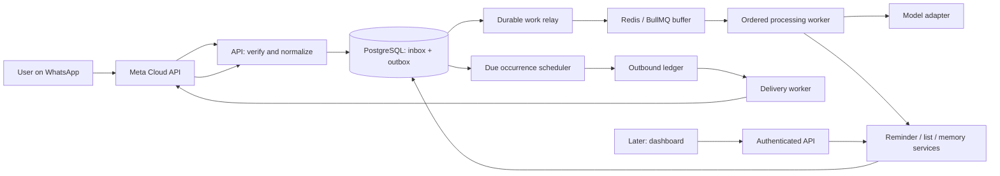
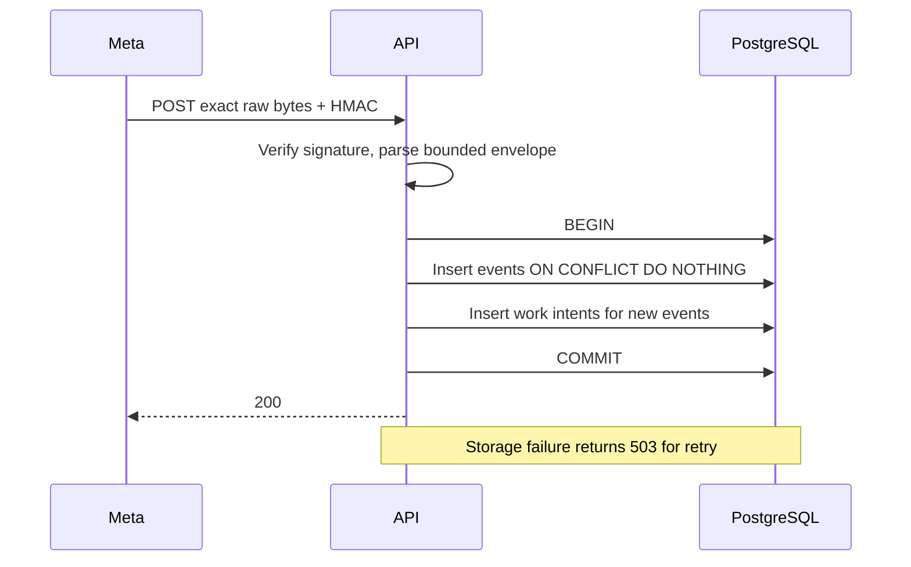

# Architecture and system design

Status: proposed system with implemented ingress foundation. Updated 2026-10-27. Assumptions: solo developer, small private beta, WhatsApp first, TypeScript, one region, managed PostgreSQL at launch. Country, hosting, languages and provider choices remain open in [decisions](decisions/README.md).

## Shape and boundaries

Use a **modular monolith in one repository**, deployed as an API and one or more workers. This preserves database transactions and simple debugging while allowing ingress and background load to scale separately. Split services only when measurements or team ownership justify it.

Only the API-to-inbox/outbox path and worker backlog diagnostics exist today. Redis is provisionable, not integrated. Model, scheduler, sender, authenticated API and dashboard are planned.

| Module     | Owns                                                        | Must not own                                  |
| ---------- | ----------------------------------------------------------- | --------------------------------------------- |
| WhatsApp   | Provider payloads, signatures, normalization, send adapter  | Business rules or model prompts               |
| Identity   | Phone identity, timezone confirmation, consent, sessions    | Inferring timezone from phone prefix          |
| Processing | Ordered context, model decision, validated action plan      | Raw provider-specific network code            |
| Reminders  | Schedule intent, lifecycle, occurrences                     | Direct outbound network sends                 |
| Lists      | Lists and normalized items, fuzzy resolution                | Arbitrary cross-user IDs from model output    |
| Delivery   | Send intents, attempts, templates, receipts, reconciliation | Claiming delivered on HTTP acceptance         |
| Memory     | Fact provenance, supersession, retrieval, deletion          | Duplicating reminders as memories             |
| Calendar   | OAuth and idempotent external event tasks                   | Claiming success before provider confirmation |
| Usage      | Atomic reservations, usage events, spend policy             | Guessing fixed vendor prices                  |

Dependencies flow from API/worker to application services, then domain rules and adapter interfaces. Provider adapters implement interfaces. Domain logic should be testable without network calls. SQL migrations are authoritative initially; adding Drizzle later requires one migration owner and no parallel schema sources.

## Durable ingress (implemented)

Keys hash a structured tuple: message + business phone + provider message ID; status + business phone + provider message ID + state + provider timestamp. JSON property order does not change identity. A batch commits all accepted events and work intents together. Unknown non-message change fields are ignored; unknown message types are retained for a future unsupported-type response. Raw message/status JSON is staged internally, so real-user traffic needs a short retention policy and restricted role before launch.

## Queue handoff and recovery (M1)

The outbox is the durable task register. A relay leases pending rows or expired leases using database time and `FOR UPDATE SKIP LOCKED`. Each claim gets a fresh token and lease expiry. It publishes only opaque event IDs to BullMQ. After publication it does **not** mark the task completed: a queue flush must still be recoverable. Consumers mark completion only with committed durable effects. A watchdog republishes expired incomplete work. Duplicate queue jobs are allowed; database idempotency makes retries safe.

Queue job IDs use safe UUID/hash strings, not raw WhatsApp IDs. Retry transient dependency errors with jitter and bounded attempts. Invalid payloads become dead tasks with stable error codes. Expired leases are reclaimed; compare the lease token on final writes to fence stale workers. Leases need renewal while model calls run. Queue availability is never a prerequisite for webhook acknowledgement.

## Ordering and action execution (M1)

Serialize by authenticated user (initially business-phone + sender mapping). Acquire a dedicated session advisory lock, then select the oldest unprocessed event for that user by durable sequence. Do not assume that whichever queue job obtained a lock is next. Acquire/release on the same database connection and release in `finally`; connection loss releases the lock. Do not hold an open SQL transaction across an LLM call.

Global identity sequences can be allocated before another ingress transaction commits. The acceptance contract is **durably visible receipt order**, not perfect sender order. For closely arriving batches, use a short coalescing window and provider timestamps as context. Do not claim strict order across arbitrarily delayed provider webhooks. Add concurrency tests and document late-arrival behavior before enabling reference edits.

Persist the validated model plan before execution. On retry, reuse it; do not regenerate a potentially different list of actions. Derive action keys from inbound event ID + plan version + action index + kind. Within one transaction, insert the action receipt, apply entity changes, and enqueue reply intent. An existing receipt returns the original result. User identity comes from server context. All references must resolve within the user scope. Model-provided confidence is a routing signal, not authorization or calibrated truth.

## Scheduling and delivery (M2)

PostgreSQL stores `next_due_at`. Every 30 seconds, a sweeper locks due rows with `next_due_at <= now()`, creates the uniquely keyed occurrence and durable outbound intent, and advances recurrence in the **same transaction**. No network send happens under the lock. Never mark an occurrence delivered merely because it was scheduled.

Prefer atomic claim-and-materialize transactions rather than persistent reminder claim flags. Where a longer lease is necessary, exclude active leases, reclaim expired ones, and fence updates. Delivery workers recheck `available_at`, cancellation/version, consent, quota, and the service window at actual send time. Exact-time reminders are not delayed to save cost. Digests and quiet-hour deferrals are explicit user preferences with a separately recorded promised delivery time.

Recurring rules retain IANA zone, local time, start date, supported RRULE and end. Define DST gap/fold behavior: proposed gap policy shifts forward by the gap; fold policy uses the first occurrence, once. Review that policy in UX and test it explicitly. Reject unsupported recurrence rules; never advance a local daily rule with UTC +24 hours.

## Delivery guarantees and unknown outcomes

Internal state changes are idempotent under retries. External exactly-once sending is **not guaranteed** without documented provider idempotency or reconciliation. A request may be accepted by Meta while the response is lost. Persist a send attempt before the request. After a timeout or crash in the uncertain window, mark it `unknown`; do not automatically resend. Reconcile receipts when correlation is possible and surface unresolved attempts for operator action. This chooses a visible uncertainty over silently duplicating reminders.

Store delivery receipts before matching them. A status may arrive before the send response is committed. Merge positive progress monotonically (`accepted → sent → delivered → read`), retain event history, and prevent a late failure from erasing evidence of delivery. Receipt timestamps, not worker receipt time, measure delivery where trustworthy. Provider acceptance and delivery have different metrics.

## Isolation, privacy and spend

The transport staging tables are internal and pre-user; a narrow ingress role may insert/dedupe only. Product tables use tenant-aware foreign keys and forced RLS, with `SET LOCAL app.user_id` inside every application transaction. Runtime roles must not own tables or have superuser/BYPASSRLS privileges. Scheduler access is narrow and explicit. Test cross-user reads, writes, foreign keys and pooled-connection reuse before any user CRUD endpoint ships.

Consent and timezone confirmation precede model processing. Raw content never enters ordinary logs. Model traces use redacted metadata by default. Proposed staging retention is 7 days for unconsented/unprocessed content, 30 days for opted-in raw messages during beta; final policy is an explicit product decision. Secret storage is unsupported in the first version; later encryption must cover inbox, traces, backups and memory, not just a single memory column.

Reserve model/send budget atomically before spending, then settle usage from actual token counts and delivery charges. Rate-limit onboarding and processing separately. Quota exhaustion must be visible; avoid accepting reminders that cannot be delivered under the current plan. A global kill switch pauses new spend while preserving durable work.

## Deployment, measurements and growth

Start with API + worker + managed PostgreSQL/PITR in one region. Add managed Redis when the relay is implemented. Configure external TLS, private DB networking, scoped secrets, readiness probes, migration release step, backups and restore drills. The checked-in Compose file is local-only.

Targets from the playbook remain goals, not measurements: webhook p99 <200 ms, response p50 <3 s / p95 <6 s, and immediate reminder delivery within 60 seconds for 99.5% of eligible occurrences. Track queue age, DB saturation, model latency, correction rate, unknown sends and cost alongside these. Include undelivered eligible occurrences in the SLO denominator; report quiet-hours/digest deferrals and user cancellations separately. See [operations](operations.md).

Scale workers by backlog age and measured provider/DB limits. Tenant locks, bounded connection pools, batch sweeps, query plans and retention come before microservices. Benchmark tenant-filtered vector recall when adding memory; do not assume a global HNSW index guarantees good per-user recall or latency.
