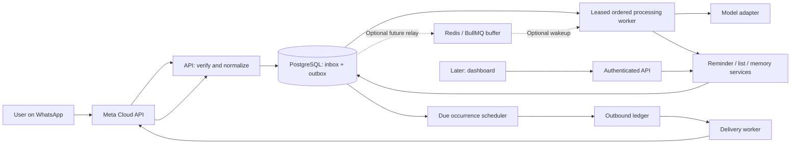
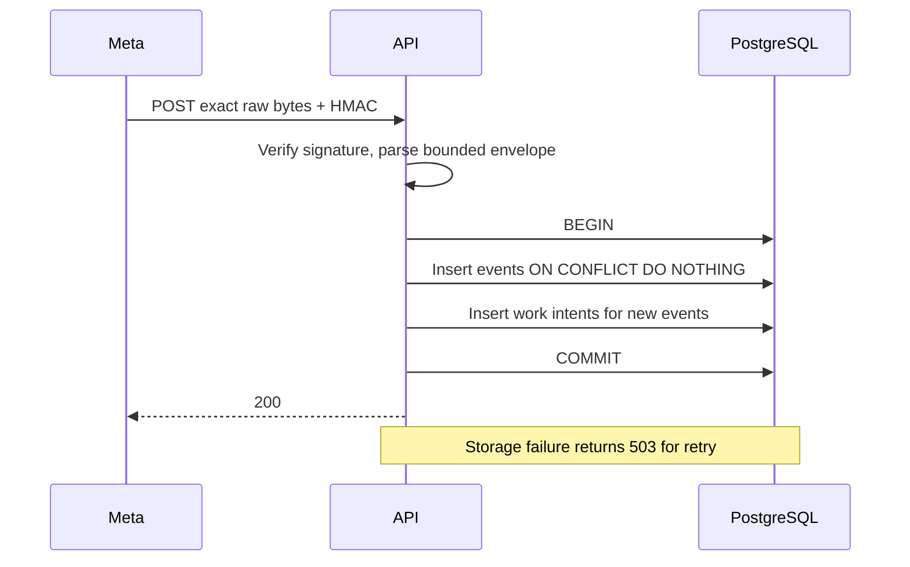

# Architecture and system design

Status: target system with implemented ingress, identity, tenant isolation, work leases, persisted plans, usage controls, local action execution, due scheduling and tested reminder delivery. Live outbound remains disabled. Updated 2026-10-28. Assumptions: solo developer, small private beta, WhatsApp first, TypeScript, one region, managed PostgreSQL at launch. Country, hosting, languages and provider choices remain open in [decisions](decisions/README.md).

## Shape and boundaries

The current reminder path is saved plan -> reminder -> occurrence + outbound intent -> durable send attempt -> provider acceptance -> delivery receipts. M2-02 implements the last stages through an injectable test service and the existing receipt worker. It does not activate live sending. Template versions and selected message payloads are persisted, while network calls run outside database transactions. See [reminder delivery](reminder-delivery.md).

Use a **modular monolith in one repository**, deployed as an API and one or more workers. This preserves database transactions and simple debugging while allowing ingress and background load to scale separately. Split services only when measurements or team ownership justify it.

The API-to-inbox/outbox path, local identity/onboarding, tenant isolation, staged leased worker, model adapter and immutable plans exist today. Onboarding responses are stored without sending them. Redis is provisionable but unused. Local action execution and reply intents are implemented. M2-01 one-time occurrence scheduling is implemented. Live model activation, the reminder sender, authenticated API and dashboard remain planned. See [onboarding](onboarding.md) and [work processing](work-processing.md).

| Module     | Owns                                                        | Must not own                                  |
| ---------- | ----------------------------------------------------------- | --------------------------------------------- |
| WhatsApp   | Provider payloads, signatures, normalization, send adapter  | Business rules or model prompts               |
| Identity   | Phone identity, timezone confirmation, consent, sessions    | Inferring timezone from phone prefix          |
| Processing | Ordered context, model decision, validated action plan      | Raw provider-specific network code            |
| Reminders  | Schedule intent, lifecycle, occurrences                     | Direct outbound network sends                 |
| Lists      | Lists and normalized items, fuzzy resolution                | Arbitrary cross-user IDs from model output    |
| Delivery   | Send intents, attempts, templates, receipts, reconciliation | Claiming delivered on HTTP acceptance         |
| Memory     | Fact provenance, supersession, retrieval, deletion          | Duplicating reminders as memories             |
| Calendar   | OAuth and idempotent external event tasks                   | Claiming success before provider confirmation |
| Usage      | Atomic reservations, usage events, spend policy             | Guessing fixed vendor prices                  |

Dependencies flow from API/worker to application services, then domain rules and adapter interfaces. Provider adapters implement interfaces. Domain logic should be testable without network calls. SQL migrations are authoritative initially; adding Drizzle later requires one migration owner and no parallel schema sources.

## Durable ingress (implemented)

Keys hash a structured tuple: message + business phone + provider message ID; status + business phone + provider message ID + state + provider timestamp. JSON property order does not change identity. A batch commits all accepted events and work intents together. Unknown non-message change fields are ignored; unknown message types are retained for a future unsupported-type response. Raw message/status JSON is staged internally, so real-user traffic needs a short retention policy and restricted role before launch.

## Queue handoff and recovery (M1)

The outbox is the durable task register and current queue. The worker claims due pending rows atomically using database time and `FOR UPDATE SKIP LOCKED`. Each claim receives a fresh token, owner and expiry; preparation runs outside a transaction while a heartbeat renews the lease. Short database effects and acknowledgement commit together after checking the token and expiry before and after the effects. Each cycle recovers expired claims with bounded attempts. Stable error codes, jittered backoff and audited operator retry make failures recoverable. See [work processing](work-processing.md).

Redis/BullMQ may later provide wakeups, but queue publication must never mark a durable task complete. PostgreSQL remains authoritative after buffer loss. External calls require their own idempotency and uncertainty handling.

## Ordering and action execution (M1)

Ingress acquires transaction advisory locks per business-phone/sender stream before allocating sequence values, in sorted order for batches. Claims select the earliest incomplete item in each stage. Onboarding may advance past action backlog so consent controls remain available. Later planning/execution waits for earlier incomplete onboarding, planning and execution; dead or backing-off predecessors block their stream. Receipt streams use business phone and provider message ID.

The acceptance contract is committed ingress order established by stream-lock acquisition, not perfect sender order. Delayed provider messages join the end and cannot reorder committed effects. There is no coalescing window. Current identity rules reject stale control/consent transitions; ambiguous late reference edits need explicit handling when those features arrive. Action handlers must recheck current consent/timezone before preparation and under the user row lock in their final transaction.

The M1-04 planner persists validated decisions and transitions work to a separate execution stage in one fenced transaction. It rechecks consent and timezone under the user row lock. The OpenAI transport is implemented but disabled in the worker; optional fixture mode exercises persistence offline. See [model plans](model-plans.md).

The M1-06 executor uses the validated model plan saved before execution. On retry, reuse it; do not regenerate a potentially different list of actions. Derive action keys from inbound event ID + plan version + action index + kind. M1-06 commits action receipts, entity changes, execution outcome, reply intent and work acknowledgement together. See [action execution](action-execution.md). An existing receipt returns the original result. User identity comes from server context. All references must resolve within the user scope. Model-provided confidence is a routing signal, not authorization or calibrated truth.

## Scheduling and delivery (M2)

M2-01 uses the existing one-time `reminders.due_at`, a schedule version and a `scheduled_at` materialization marker. Each worker cycle runs a bounded sweeper after identity/execution work; it locks users then due reminders, creates one occurrence/outbound intent and marks the reminder in the **same transaction**. The default 30-second poll delay is not a delivery guarantee. Identity changes suppress stale work. No network send happens under the lock, and scheduling does not mark delivery. Recurrence advancement remains future work. See [scheduling](reminder-scheduling.md).

Prefer atomic claim-and-materialize transactions rather than persistent reminder claim flags. Where a longer lease is necessary, exclude active leases, reclaim expired ones, and fence updates. Delivery workers recheck `available_at`, cancellation/version, consent, quota, and the service window at actual send time. Exact-time reminders are not delayed to save cost. Digests and quiet-hour deferrals are explicit user preferences with a separately recorded promised delivery time.

Recurring rules retain IANA zone, local time, start date, supported RRULE and end. Define DST gap/fold behavior: proposed gap policy shifts forward by the gap; fold policy uses the first occurrence, once. Review that policy in UX and test it explicitly. Reject unsupported recurrence rules; never advance a local daily rule with UTC +24 hours.

## Delivery guarantees and unknown outcomes

Internal state changes are idempotent under retries. External exactly-once sending is **not guaranteed** without documented provider idempotency or reconciliation. A request may be accepted by Meta while the response is lost. Persist a send attempt before the request. After a timeout or crash in the uncertain window, mark it `unknown`; do not automatically resend. Reconcile receipts when correlation is possible and surface unresolved attempts for operator action. This chooses a visible uncertainty over silently duplicating reminders.

Store delivery receipts before matching them. A status may arrive before the send response is committed. Merge positive progress monotonically (`accepted → sent → delivered → read`), retain event history, and prevent a late failure from erasing evidence of delivery. Receipt timestamps, not worker receipt time, measure delivery where trustworthy. Provider acceptance and delivery have different metrics.

M1-07 implements this boundary for test replies: one durable attempt per source event, bounded transport, separate acceptance/delivery states, and an active leased receipt consumer. Uncertain calls are held without redispatch. Receipt and send-result transactions share a provider-message lock to reconcile early evidence. The regular worker does not construct a live sender; Meta qualification, replacement consent, delivery pricing, templates and audited retry/reconciliation remain prerequisites for outbound activation. See [WhatsApp delivery](whatsapp-delivery.md).

## Isolation, privacy and spend

The transport staging tables are internal and pre-user; a narrow ingress role may insert/dedupe only. Product tables use tenant-aware foreign keys and forced RLS, with `SET LOCAL app.user_id` inside every application transaction. Runtime roles must not own tables or have superuser/BYPASSRLS privileges. Scheduler access is narrow and explicit. Test cross-user reads, writes, foreign keys and pooled-connection reuse before any user CRUD endpoint ships.

Consent and timezone confirmation precede model processing. Raw content never enters ordinary logs. Model traces use redacted metadata by default. Proposed staging retention is 7 days for unconsented/unprocessed content, 30 days for opted-in raw messages during beta; final policy is an explicit product decision. Secret storage is unsupported in the first version; later encryption must cover inbox, traces, backups and memory, not just a single memory column.

M1-05 reserves model budget atomically in global/user UTC-month counters, then settles trusted token usage separately from plan persistence. It holds uncertain attempts and rechecks the global switch at dispatch. See [usage controls](usage-controls.md). Send-budget integration is a future delivery requirement. Rate-limit onboarding and processing separately. Quota exhaustion must be visible; avoid accepting reminders that cannot be delivered under the current plan. A global kill switch pauses new spend while preserving durable work.

## Deployment, measurements and growth

Start with API + worker + managed PostgreSQL/PITR in one region. Add managed Redis when the relay is implemented. Configure external TLS, private DB networking, scoped secrets, readiness probes, migration release step, backups and restore drills. The checked-in Compose file is local-only.

Targets from the playbook remain goals, not measurements: webhook p99 <200 ms, response p50 <3 s / p95 <6 s, and immediate reminder delivery within 60 seconds for 99.5% of eligible occurrences. Track queue age, DB saturation, model latency, correction rate, unknown sends and cost alongside these. Include undelivered eligible occurrences in the SLO denominator; report quiet-hours/digest deferrals and user cancellations separately. See [operations](operations.md).

Scale workers by backlog age and measured provider/DB limits. Tenant locks, bounded connection pools, batch sweeps, query plans and retention come before microservices. Benchmark tenant-filtered vector recall when adding memory; do not assume a global HNSW index guarantees good per-user recall or latency.
