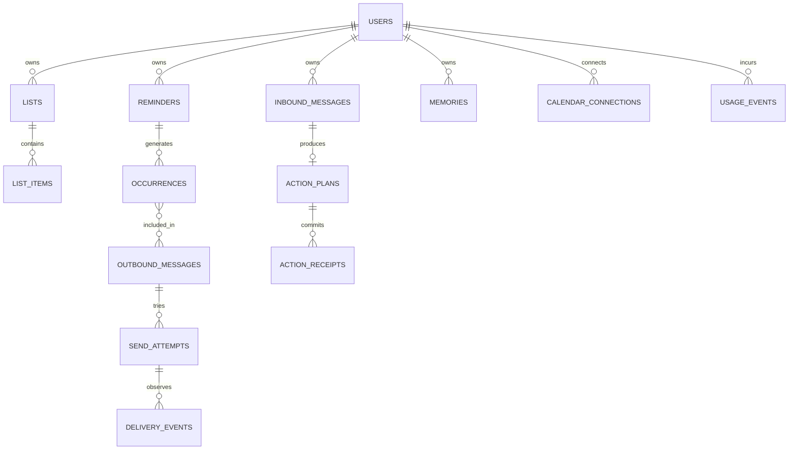

# Data model

The executable schema includes `schema_migrations`, `ingress_events`, `work_outbox`, `users`, `identity_results`, `consent_events`, `user_preferences`, `work_recovery_events`, and `action_plans`. Migrations 0002/0003 add onboarding. Migration 0004 adds forced RLS, separate runtime grants, preferences, and message/audit ownership constraints. Migration 0005 adds staged renewable work leases, attempt limits and recovery audit. Migration 0006 adds immutable tenant-scoped plans and the execution stage. See [model plans](model-plans.md). See [tenant isolation](tenant-isolation.md) and [work processing](work-processing.md). Migration 0007 adds usage policy, per-user limits, model rate cards, monthly global/user counters, reservations and operator audit. See [usage controls](usage-controls.md). Migration 0008 adds `lists`, `list_items`, `reminders`, `action_receipts`, `plan_executions`, and `reply_intents`, with forced RLS and owner-aware foreign keys. See [action execution](action-execution.md). Migration 0009 adds `whatsapp_attempts` and `whatsapp_receipts`, forced tenant RLS, source ownership constraints and delivery address bindings. See [WhatsApp delivery](whatsapp-delivery.md). Migration 0010 adds `reminder_occurrences`, `outbound_messages`, schedule versions and a materialization marker with forced RLS and owner-aware references. See [scheduling](reminder-scheduling.md). The target section describes later extensions; those are not all implemented.

## Current schema

Migration 0019 adds administrator-only telemetry counters, runtime heartbeats, batch deduplication, monitoring expectations, one current snapshot, fixed alert states and transition history. Runtime roles can only record their own component through a validated function. No account/content fields are added to monitoring storage. See [telemetry](telemetry.md).

Migration 0018 adds `privacy_requests`, `privacy_actions`, the account deletion marker, ingress redaction timestamps, private replay fingerprints/key, retention policy and aggregate privacy-operation records. Ownership foreign keys support atomic administrator erasure without granting runtime DELETE access. See [privacy](privacy.md).

Migration 0017 adds administrator-owned quota policy/audit, tenant-isolated account blocks and counters, immutable request admissions with event-owner validation, and shared global attempt counters. See [quotas](quotas.md).

Migration 0016 adds forced-RLS `delivery_preferences`, immutable delivery previews in `delivery_choices`, and per-event `delivery_preference_actions`. Deferred reminders store a separate promised instant and confirmed choice reference; occurrence constraints permit explicit deferral while requiring immediate promises to equal the original due time. Outbound availability uses the saved promise. See [delivery preferences](delivery-preferences.md).

Migration 0015 adds list references/revisions, item revisions, forced-RLS `list_choices`, owner-constrained `list_choice_options`, and immutable `list_actions`. Triggers version additions and text/completion changes. Choice options bind exact list/item revisions; receipt triggers verify event ownership. Item positions remain append-only and protected from runtime edits. See [list management](list-management.md).

Migration 0014 adds `reminder_series`, `reminder_series_actions` and owner-aware reminder membership with a unique nominal date per series. Proposals persist a bounded exact-date array, cadence/end, source version/instant, IANA zone, identity snapshots, DST policy and timezone-data version. Confirmation creates independent reminder rows atomically; each still has its own delivery occurrences and controls. This finite-series implementation replaces the target inline recurrence-fields design below for the supported daily/weekly subset. See [recurring reminders](recurring-reminders.md).

Migration 0013 adds `reminder_controls` (one owner/identity/version-bound reference per reminder schedule) and immutable `reminder_mutations` (one outcome/reply per inbound event). Both force tenant RLS. A database trigger verifies each mutation's event belongs to its user. Lifecycle changes increment the schedule version, invalidate controls, and suppress prior occurrences/outbound intents; snooze also changes the due instant and clears the scheduling marker. Worker updates are limited to reminder lifecycle/scheduling columns. See [reminder controls](reminder-controls.md).

Migration 0012 adds bounded attempt sequences, retry/recovery deadlines and `delivery_recovery_audit`. Source uniqueness now includes the attempt number; a predecessor guard prevents invalid retry chains. The audit is tenant-scoped and operator resolutions are protected from runtime credentials. See [delivery recovery](delivery-recovery.md).

Migration 0011 adds deployment-owned `whatsapp_templates` and extends `whatsapp_attempts` with owner-scoped outbound references, immutable message payloads and template references. See [reminder delivery](reminder-delivery.md).

| Table               | Purpose                                                  | Key invariants                                                                           |
| ------------------- | -------------------------------------------------------- | ---------------------------------------------------------------------------------------- |
| `schema_migrations` | Applied migration history                                | Unique filename; SHA-256 checksum; advisory migration lock                               |
| `ingress_events`    | Normalized inbound messages and delivery status payloads | Unique event key, monotonic identity sequence, received/processed times                  |
| `work_outbox`       | Durable pending work                                     | One task per ingress event; stage, attempts and lease token + owner + expiry constraints |

Event and work row are inserted in one transaction. Receipt events have no sender because their user is resolved later through outbound correlation. Payloads are private staging data; do not expose a generic read endpoint.

## Target entities

| Entity / milestone          | Important fields                                                                                           | Constraints and indexes                                                                    |
| --------------------------- | ---------------------------------------------------------------------------------------------------------- | ------------------------------------------------------------------------------------------ |
| `users` / M1                | UUID, normalized phone identity, zone, language, consent version/time, service-window expiry, deleted time | Unique channel + business phone + sender; timezone must be confirmed                       |
| `inbound_messages` / M1     | user, ingress event, status, context, processed time                                                       | Unique ingress event; user + sequence pending index                                        |
| `action_plans` / M1         | inbound ID, version, model/prompt IDs, validated decision                                                  | One persisted active plan per message; attempts reuse plan                                 |
| `action_receipts` / M1      | user, action key, entity kind/ID, result                                                                   | Unique user + action key; inserted with entity mutation                                    |
| `lists` / M1                | user, name, archived/deleted/created/updated                                                               | Unique active user + lower(name); unique (user,id)                                         |
| `list_items` / M1           | user, list, text, sort position, done/deleted                                                              | Composite (user,list) FK; lock list for reorder; optional trigram index                    |
| `reminders` / M1–M2         | user, title, next due, lifecycle, delivery mode, schedule version, source                                  | Partial due index on pending/nondeleted; unique (user,id); owner-aware references          |
| Recurrence fields / M2      | local time, IANA zone, start date, RRULE, end                                                              | All-or-none rule/time/zone; supported subset validation                                    |
| `reminder_occurrences` / M2 | user, reminder, original instant, promised delivery instant, status, schedule version                      | Unique (reminder, schedule version, original instant); composite owner FK; due index       |
| `outbound_messages` / M1–M2 | user, idempotency key, message kind/template/locale, payload, available time, status                       | Unique logical key; current state separate from immutable attempts                         |
| `outbound_occurrences` / M2 | user, outbound ID, occurrence ID                                                                           | Join table supports digests and retries; owner-aware FKs                                   |
| `send_attempts` / M2        | outbound, attempt number, started/finished, provider ID, outcome, error code                               | Unique outbound + attempt; provider ID unique in phone scope when present                  |
| `delivery_events` / M2      | provider ID, status, provider event time, raw event ref, matched attempt                                   | Unique status identity; unmatched index; retain out-of-order observations                  |
| `usage_events` / M1–M3      | user, reservation key, type, units, tokens, estimated/settled cost, rate version                           | Append-only accounting; unique operation + charge type                                     |
| `usage_counters` / M3       | user, period, reserved + settled units/cost                                                                | Atomic reserve/check/update; period definition explicit                                    |
| `memories` / M4             | user, nullable plaintext, ciphertext envelope, provenance, supersedes ID, expiry, model/dimensions         | Check plaintext XOR ciphertext; no secret plaintext/vector; owner-aware supersession       |
| `memory_embeddings` / M4    | user, memory ID, embedding model/version, vector                                                           | Dimension tied to model migration; tenant-filtered retrieval tests                         |
| `calendar_connections` / M4 | user, provider, account, encrypted access/refresh envelopes, expiry/state                                  | Distinct nonce/tag for each encrypted value; unique active connection                      |
| `privacy_requests` / M3     | user, export/delete kind, reference, status, expiry                                                        | Confirmed deletion cancels work; administrator erasure waits for unresolved external calls |

## Conventions

- Store instants as `timestamptz`, recurrence wall time as `time`, billing dates as `date`. Do not use a UTC offset as an IANA timezone.
- Give tenant tables a `user_id`. Parent relations must enforce matching ownership with composite FKs, not just an unscoped UUID FK.
- Prefer checks/enums for lifecycle states. Currency is fixed-precision numeric or integer micros, never floating-point money.
- Soft deletion supports short undo windows; it is not account erasure. Purge follows the retention/deletion policy.
- Derive service-window expiry from the provider's inbound timestamp using a monotonic max, with a bounded future-skew check. Delayed replay must not reopen an expired window.
- Query with bounded pagination. Use a consistent `(created_at,id)` cursor rather than offset pagination for growing histories.
- Add RLS plus `WITH CHECK`, forced enforcement and non-owner runtime roles when tenant tables are introduced. Transport tables instead use restricted internal access.
- Preserve occurrence identity when quiet hours change availability. Reschedule increments schedule version and invalidates unsent stale intents transactionally.

## Migration order

1. Transport inbox/outbox (done).
2. Users, consent, roles/RLS and ownership test helpers.
3. Plans (0006), action receipts, lists/items, reminders and reply intents (0008) are implemented. The test delivery ledger is implemented in 0009; live activation remains.
4. Usage reservations (0007), test send attempts/receipts (0009), one-time scheduling (0010), templates (0011), bounded retry/reconciliation (0012) and complete/cancel/snooze controls (0013) are implemented. Finite daily/weekly recurrence is implemented in 0014; broader recurrence and live activation remain.
5. Retention/export/deletion jobs and operations indexes.
6. pgvector extension and memory schema after embedding dimensions are selected; calendar token envelopes separately.

Use expand/backfill/contract for incompatible changes. Test migrations on an empty database and a representative prior schema. Roll back application code only when the new schema remains compatible; use a forward corrective migration for committed data changes. Verify backups before destructive releases.
