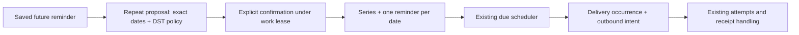

# M2-05: daily and weekly recurring reminders

Recurring reminders are implemented as a finite series of independently controllable reminders. For example, completing Monday's “Take out recycling” does not complete next Monday's reminder. Snoozing today by 15 minutes leaves all later dates unchanged.

## Try the command flow

Start with a saved **future** one-time reminder and its current reference. Its title, confirmed timezone, local time and first date become the series starting point. Weekly recurrence also uses that first date's weekday.

```text
REPEAT 0123456789abcdef DAILY UNTIL 2026-12-31
```

Or use `WEEKLY` instead of `DAILY`. Replace the reference and end date with your own. The end date is inclusive in the saved timezone; it must include at least two dates and be no more than 365 days after the first reminder. A daily series therefore contains at most 366 reminders. There is no automatic extension past that date.

The response shows the next five dates (or all dates if fewer), exact timezone offsets, number of reminders, and the daylight-saving policy. It supplies a separate series reference:

```text
CONFIRM REPEAT <series reference>
```

The preview expires after 15 minutes or when the original reminder becomes due. Until confirmation, the original reminder remains unchanged. Confirmation includes that reminder as the first occurrence, rotates its control reference, and saves the remaining dates exactly as previewed. It does not duplicate the original reminder. A changed reminder, expired preview, changed consent or changed timezone requires a new preview.

Each delivered occurrence includes its own `DONE`, `CANCEL` and `SNOOZE` references, including on the template path outside the WhatsApp service window. These affect that occurrence only. To stop the entire series:

```text
CANCEL SERIES <series reference>
```

Cancelling an unconfirmed proposal leaves the original reminder unchanged. Cancelling an active series cancels pending occurrences and suppresses queued deliveries/retries. Completed/cancelled history and accepted/unknown delivery evidence remain intact. A send already authorized cannot be recalled.

These are deterministic commands in the onboarding worker. The frozen `decision-v1` model and its 60 evaluation cases still support only one-time reminder creation/list additions. Free-form requests such as “remind me every Monday” require a later model contract/evaluation update; use the explicit repeat flow for now. Monthly rules, multiple weekdays, custom intervals, indefinite repetition, editing an active series, and automatic series timezone migration are outside this milestone.

## Daylight-saving and calendar rules

The policy is named `gap-forward-fold-first-v1` and is shown before confirmation:

- Keep the saved local clock time on each calendar day or every seventh calendar day. Never add a fixed 24 or 168 UTC hours.
- If the clock skips that time, move forward by the size of the gap for that date only. Toronto 02:30 becomes 03:30 on its spring-forward date; subsequent days return to 02:30.
- If a time occurs twice, use the earlier occurrence once. Toronto 01:30 uses the summer-time offset on its fall-back date. An initial reminder explicitly selecting the second occurrence cannot be converted under this policy; choose the first occurrence before repeating.
- Non-hour transitions use their actual gap, including Lord Howe's 30-minute change. Whole-date offset changes coalesce duplicate/non-increasing instants rather than producing two reminders at the same instant.

The implementation uses pinned `@js-temporal/polyfill` 0.5.1 with Temporal's `compatible` disambiguation. References: [TC39 timezone/disambiguation documentation](https://tc39.es/proposal-temporal/docs/timezone.html) and [polyfill releases](https://github.com/js-temporal/temporal-polyfill/releases). Runtime IANA timezone data comes from Node/ICU; its version is saved with the proposal. Exact dates are frozen when previewed. A later timezone-database update does not silently rewrite an existing promise; if relevant rules change, cancel the old series and preview a replacement.

Changing the user's timezone or withdrawing consent suppresses the old series and invalidates its controls. Existing reminder snapshot checks prevent its children from sending after re-consent or a new timezone confirmation. The app does not reinterpret an old series in a newly chosen zone.

## Architecture and database



Migration `0014_reminder_recurrence.sql` adds:

| Data                                        | Purpose                                                                                                                                                                                            |
| ------------------------------------------- | -------------------------------------------------------------------------------------------------------------------------------------------------------------------------------------------------- |
| `reminder_series`                           | Owner, source reminder/version/instant, daily/weekly cadence, inclusive end date, frozen timezone/identity, DST policy, timezone-data version, immutable date array, proposal expiry and lifecycle |
| `reminders.series_id` / `series_local_date` | Owner-aware series membership and unique nominal calendar date; snooze changes due time without changing membership                                                                                |
| `reminder_series_actions`                   | Immutable per-event proposal/confirmation/cancellation outcome and response; trigger verifies the event's phone/sender belongs to the user                                                         |

Both new tables force tenant RLS. Tenants may read their own records; ingress has no access. Workers cannot edit the compiled rule, dates or action receipts. They can change series status and attach reminders through restricted column grants. The worker remains trusted across tenants, as in [tenant isolation](tenant-isolation.md).

Confirmation holds the user lock, checks the source version and identity, and inserts all remaining dates in **one bounded database operation**. Series status, first-reminder linkage/control rotation, children, command receipt, identity reply and lease acknowledgement commit together. A failure or lost lease rolls back every effect. Competing confirmations cannot attach the same source twice. The event receipt makes retries idempotent; a separate confirmation of an already consumed proposal is stale.

There is no separate recurrence cursor or recurring network job. The existing due scheduler already handles each saved child, skips busy users, bounds each pass, and deduplicates delivery occurrences. A restart needs no special recurrence repair. Overdue children retain their promised times and pass through the existing queue in bounded batches; this milestone does not add a catch-up digest or silently discard missed dates. Recurring outbound bodies contain the occurrence reference and the whole-series cancellation command.

Cancellation uses the same user lock as mutation, scheduling, dispatch and recovery. It suppresses existing intents and exhausts queued retries atomically, adding recovery audit records. Late rejections cannot requeue cancelled children; unknown sends still use the existing reconciliation workflow. See [reminder controls](reminder-controls.md) and [delivery recovery](delivery-recovery.md).

## Verification and local setup

Stop older workers, run `npm run db:migrate`, then `npm run check` and restart the worker. No new environment variables, provider credentials or live-sending switch are required. The onboarding simulator can process these commands for its own synthetic user's saved reminders; fixture model mode still generates clarification rather than arbitrary reminder creation.

Unit fixtures verify the next five daily dates across Toronto spring/fall transitions, five weekly dates across DST, Lord Howe's half-hour gap, Kathmandu, leap day, microsecond preservation, a skipped Apia date, rule bounds and command parsing. PostgreSQL tests use real restricted logins and exercise preview/confirmation, exact schedule persistence, replay, races, stale/expired/foreign controls, invalid rules, 366-date activation, transaction/lease rollback, scheduler replay, per-occurrence snooze/complete, whole-series cancellation, retry/evidence preservation, template delivery, settings changes and RLS/event ownership. All sends are mocked.

Live model calls and WhatsApp sending remain disabled. The next implementation milestone is **M2-06: list reading, editing and completion with clarification for ambiguous matches**. The beginner PDF remains the M1-08 historical snapshot.
