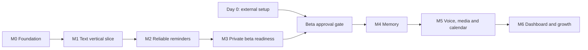

# Delivery roadmap

This plan assumes one developer and a small private beta. Estimates are focused working time, not guaranteed calendar dates. The playbook's 4–5 weeks is aggressive for its full feature set. Plan **5–8 full-time weeks for a reliable text-first beta**, followed by **4–7 weeks for memory, media, calendar and dashboard**, plus external approval delays. At 10–15 hours/week, expect substantially longer. Re-estimate after the first vertical slice using actual throughput.

## Scope and sequencing

**First usable beta:** consent + timezone, one-time reminders, named lists, safe clarification, verified WhatsApp ingress, template delivery, delivery evidence, limited recurrence, quotas, export/delete, monitoring and restore capability.

**Next:** hybrid memory, voice, images, Google Calendar, localized templates, daily briefings and minimal dashboard. Telegram, email, Outlook, friend reminders, billing tiers and a large dashboard wait until core usage supports them. Do not store passwords or send to third parties in the first release.

## Day 0 — start external dependencies now

Owner: you. Allow 0.5–2 days of setup; approvals may take longer and should run alongside development.

- Choose the first target country, 10–20 intended beta users, and primary language. Confirm their reminder/list needs before expanding features.
- Create or select the Meta business/app setup and a dedicated test/business number. Start required verification; confirm current account-specific limits and policy eligibility for this assistant use case. Do not assume access or template approval from the PDF.
- Draft reminder templates with realistic samples and fixed surrounding text. Submit only after reviewing current rules; keep template name, locale, approval and quality status in an integration checklist.
- Choose a model provider and set account spend controls. Record model IDs only after evaluating them.
- Choose one hosting region and a managed PostgreSQL provider with backup/restore support. Keep staging separate from production.
- Resolve privacy ownership, intended markets, retention, consent text and processor disclosures before accepting real personal data.

**Exit:** external-dependency tracker has owner, submission date, status, next action and blocker for each item. Test-number access is sufficient to continue local work.

## M0 — repository and design foundation (started here)

Estimate: 1–3 days total. Goal: reproducible setup and agreed architecture.

Completed in this scaffold: source boundaries, TypeScript API/worker, signed ingress, transactional inbox/outbox, migration runner, local infra config, CI definition, unit/integration tests, draft contracts/prompt, 12 evaluation fixtures and offline scoring, system design and backlog.

Local Compose, migration re-run, PostgreSQL integration tests, API readiness and Docker image build are now verified. The repository has an initial commit and remote. Choose the issue tracker and review open decisions. M1 identity/consent/timezone handling now works locally; work leasing/recovery and ordered onboarding are implemented; action execution and receipt handling work locally; real AI evaluation and live outbound sending remain pending. See [onboarding](onboarding.md).

**Exit demo:** signed fixture persists once under replay; unsigned data is rejected; simulated storage outage gets 503; database returns to ready after recovery. Save evidence in the work item.

## M1 — one complete text interaction (5–8 days)

Build in dependency order:

1. User mapping, onboarding consent and confirmed timezone; tenant roles/RLS with cross-user tests.
2. Work leasing, expiry recovery, per-user oldest-message processing and orderly shutdown.
3. Model adapter with timeouts, validated schema, token/cost metadata, and a persisted action plan.
4. Atomic usage reservations before paid calls; a basic global spend stop.
5. One-time reminder creation and list addition with action receipts; reply intent committed with the action.
6. WhatsApp send adapter on the test number and status ingestion; initially test-number traffic only.
7. Expand to 60 reviewed eval cases and generate real predictions before optimizing prompts.

M1-01 through M1-08 are implemented locally: identity/consent/timezone, tenant isolation, leased ordered onboarding, the OpenAI adapter with immutable validated plans, metered reservations with spending controls, and transactional reminder/list creation with reply intents. Live calls remain disabled; fixture mode verifies persistence without inference. M1-07 adds a tested WhatsApp transport, durable test dispatcher and active receipt consumer; live sending still awaits EXT-01 and replacement consent. M1-08 adds the real evaluation runner, 60 agent-reviewed synthetic cases and versioned reports. Human case review and a credentialed evaluation gate remain pending. M2-01 now materializes due one-time occurrences and outbound intents locally. M2-02 now provides tested reminder dispatch and template/window integration. M2-03 now adds audited reconciliation, recovery and bounded retries. M2-04 through M2-07 add lifecycle controls, finite recurrence, list management and explicit delivery preferences; see [reminder delivery](reminder-delivery.md). See [scheduling](reminder-scheduling.md). See [evaluations](../evals/README.md). See [WhatsApp delivery](whatsapp-delivery.md). See [action execution](action-execution.md). See [usage controls](usage-controls.md) for limits and operator recovery. See [model plans](model-plans.md). See [work processing](work-processing.md) for the stage and late-arrival contract.

**Exit demo:** “Remind me tomorrow at 5pm” produces a correctly scoped row and a truthful confirmation. A replay and worker retry produce one entity. “Add milk to grocery” adds one item. An unclear date asks for clarification. A model timeout does not lose or duplicate work. Non-consenting users never reach the model. Real evaluation results are recorded with model/prompt versions.

## M2 — reminders people can trust (7–10 days)

M2-01 and M2-02 are implemented locally. Due reminders become durable outbound intents; the injectable reminder sender selects text/templates and records attempts and receipt evidence. The ordinary worker still cannot send. M2-03 adds worker recovery, audited operator decisions and bounded retry chains. M2-04 through M2-07 are now implemented locally, covering lifecycle controls, finite recurrence, list management and explicit delivery preferences. See [delivery recovery](delivery-recovery.md). Actual template approval and WhatsApp budget qualification remain activation prerequisites. See [reminder delivery](reminder-delivery.md).

- Due-row sweeper, unique occurrences, atomic outbound materialization and restart recovery.
- Template fallback after service-window expiry, actual-send window recheck and approved locale selection.
- Attempt ledger, out-of-order receipts, bounded retries, unknown-outcome handling and reconciliation.
- Complete/cancel/snooze, stale-intent cancellation, signed/opaque button action IDs and owner checks.
- Supported daily/weekly recurrence with explicit DST policy and tests; monthly recurrence only when date rules are specified.
- Named-list read/edit/complete and ambiguous fuzzy-match handling.
- Optional digest and quiet hours with explicit delivery promises. Do not delay exact-time items for coalescing.

**Exit demo:** schedule, stop worker, restart, and deliver. Run two workers on the same due item and observe one internal send intent. Clear the disposable Redis buffer and recover pending work from PostgreSQL. Demonstrate Toronto spring/fall transitions and delayed delivery receipts. Explain and surface an unknown send without blind retry.

## M3 — private beta readiness (7–12 days)

M3-01 is committed and pushed: quotas, abuse controls and truthful limit messages. M3-02 is implemented locally: account-scoped administrator exports, confirmed deletion, cancellation, unresolved-outcome holds, replay protection and bounded retention. See [privacy](privacy.md). Production export delivery, provider/backup cleanup and policy review remain activation work. Next is **M3-03: telemetry, reconciliation visibility and alerts**.

- Enforce per-user/global rate and spend limits, with visible quota behavior for existing commitments.
- Authenticated export and deletion; deletion cancels work, revokes tokens and purges derived data. Retention includes logs/traces/staging/backup lifecycle.
- Redacted telemetry, queue-age and delivery alarms, delivery reconciliation and operator recovery commands.
- Managed staging deployment, private DB, secrets, release migration procedure, backup restore drill and rollback exercise.
- Failure/load tests at forecast beta traffic plus a burst. The playbook's 10,000-due-in-one-minute test is a later stress target unless beta traffic warrants it.
- Verify live account policies, template approval, limits and real rate cards. Review the entire launch checklist.
- Pilot with a few testers, then grow toward 10–20 once delivery and cost evidence support it.

**Exit:** every [launch gate](operations.md) has evidence. Observe staging/test-number delivery over several days, including outside-window templates. Target 99.5% on-time eligible deliveries; at small samples, report numerator/denominator and confidence limits rather than treating a few successes as proof. No known tenant leak, untracked unknown send or unbounded paid loop.

## M4 — useful memory (5–8 days)

- Confirm what users want remembered and whether inferred extraction is opt-in.
- pgvector schema with chosen model/dimension, source provenance and embedding jobs.
- Hybrid lexical/vector retrieval scoped to user; measure recall with a labeled set.
- Async conservative extraction, duplicate handling, supersession, edit/delete and expiry.
- Continue rejecting credential storage unless a separate reviewed encryption/retrieval UX is justified.

**Exit:** save, recall, correct and delete a fact; no cross-user result or deleted/superseded fact leaks into ordinary recall. Reminders are not duplicated as memory. Show retrieval accuracy and latency, not just a demo query.

## M5 — voice, images and Google Calendar (8–12 days)

- Voice download constraints, transcription, content retention and language evaluation.
- Tool-free media extraction followed by typed untrusted input; executor policy remains authoritative.
- OAuth state/PKCE where applicable, encrypted token envelopes, least-privilege scopes, refresh/revoke flows.
- Idempotent calendar event creation and reconciliation; user sees pending until confirmed.
- Expand to 200+ eval cases covering actual beta languages, multi-turn references, DST, injection and abstention.
- Daily briefing only after reminder/calendar/list data and template budget are reliable.

**Exit:** media cannot grant new tool authority; revoked calendar tokens cause a reconnect state; provider timeout does not double-create events; model upgrades pass the expanded gate.

## M6 — dashboard and sustained operation (5–10 days, then ongoing)

- React/Vite dashboard: reminders, lists, memory, timezone/notification settings, delivery state and account controls.
- Short-lived sessions/refresh rotation or chosen managed auth; no raw SQL/provider secrets in the client.
- Keep operations controls separate from end-user screens. Start with polling; add live updates only when useful.
- Billing/plan experiments based on measured usage, onboarding conversion and support burden.
- Monthly cost review, regular restore drills, dependency/model/API version reviews and regression fixture curation.

**Exit:** a user can inspect and correct the assistant's state and delete their account; the operator can explain failed delivery and measured per-user cost.

## Your first week

| Session | Your priority                                                           | Deliverable                                               |
| ------- | ----------------------------------------------------------------------- | --------------------------------------------------------- |
| 1       | Read README, setup and open decisions; install Docker; run checks       | Verified local setup; M0 issues closed only with evidence |
| 2       | Start Meta test-number/verification/template work; select beta audience | External tracker and product scope                        |
| 3       | Implement identity, consent and timezone flow                           | User cannot reach model before consent; ownership tests   |
| 4       | Implement durable consumer and ordered processing                       | Restart/replay test with no lost work                     |
| 5       | Connect model adapter and expand reviewed fixtures                      | First actual evaluation report                            |
| 6       | Add reminder/list action transaction and reply intent                   | One message-to-committed-action demo                      |
| 7       | Review results, fix defects, re-estimate M1/M2                          | Short release note and next 3 ready issues                |

These are work sessions, not a promise that each fits one evening. Move forward only when the prior acceptance gate passes.

## When time slips

Reduce feature breadth: defer memory, media, calendar, languages and dashboard. Keep signature verification, durability, isolation, consent, measured delivery and spending controls. If Meta approvals stall, continue with fixtures and mock provider adapters while keeping production sending blocked. If a provider policy does not permit the use case, resolve eligibility or revisit the channel before making the integration the product's foundation.
