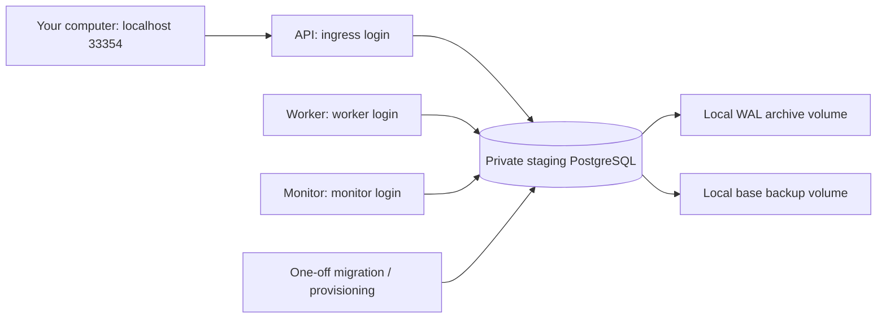

# Local Docker staging (M3-04)

Staging is a rehearsal of deployment on your computer. It runs the compiled application in containers, with a separate database and credentials. It does not use the development database or connect to OpenAI or WhatsApp. Use synthetic information only; production activation remains blocked.

The running project is `memorae-staging`. Its API is reachable at <http://127.0.0.1:33354/health/ready>. A healthy response is `200`. This is an API, not a dashboard. The API, worker, PostgreSQL and monitor have health checks; Docker restarts exited services. Docker does not automatically restart a process merely because its health check fails.

## First installation

Run from the repository root with Docker Desktop in Linux-container mode and Node.js 24. Stop if any command fails. `scripts/docker.mjs` finds Docker on Windows even when it is missing from PATH.

```powershell
npm ci
npm run check
npm run staging:setup
$env:APP_REVISION = git rev-parse HEAD
node scripts/docker.mjs compose -f compose.staging.yaml build api
node scripts/docker.mjs compose -f compose.staging.yaml up -d --wait postgres
node scripts/docker.mjs compose -f compose.staging.yaml run --rm migrate
node scripts/docker.mjs compose -f compose.staging.yaml run --rm provision
node scripts/docker.mjs compose -f compose.staging.yaml up -d --wait api worker monitor
node scripts/docker.mjs compose -f compose.staging.yaml exec -T monitor node dist/ops/main.js expect api on
node scripts/docker.mjs compose -f compose.staging.yaml exec -T monitor node dist/ops/main.js expect worker on
npm run staging:smoke
npm run staging:backup
```

These steps have already been performed on this workspace. **Do not rerun `staging:setup` here**: it refuses to overwrite the existing secret directory. Existing secrets and named volumes survive a normal stop/start. `STAGING_PORT` can override port 33354; use the same value for Compose and the smoke command.

`staging:smoke` checks both health endpoints, rejects a bad signature, submits the same signed synthetic message twice, and waits for exactly one completed onboarding result. It leaves one synthetic account/message per run. No real messages or paid calls are made. Normal planning is disabled, and the ordinary worker has no outbound sender.

## Processes and boundaries



Only the API joins the additional ingress network needed for Docker port publishing. Its host binding is loopback. PostgreSQL has no host-published port; the worker and monitor only join the internal network. The API's ingress network permits network access, but it receives only synthetic credentials and a synthetic business-phone allowlist. This is not an external firewall guarantee.

The application containers run as the image's non-root `node` user, with a read-only root filesystem, temporary `/tmp`, dropped capabilities, and `no-new-privileges`. Logs rotate at three 10 MB files per application service. PostgreSQL remains writable on its dedicated volume. The one-off archive initializer sets ownership on the two backup volumes.

## Secrets and database permissions

Think of the credentials as different keys: receiving a message does not require the key that can change the database structure.

| Component   | Mounted secrets                                                 | Database authority                                                       |
| ----------- | --------------------------------------------------------------- | ------------------------------------------------------------------------ |
| API         | Ingress database URL, synthetic signing secret and verify token | Durable ingress and its own telemetry                                    |
| Worker      | Worker database URL                                             | Existing scoped processing grants, its own telemetry                     |
| Monitor     | Monitor database URL                                            | Numeric snapshots, diagnostic lifecycle columns, alerts and expectations |
| Migrator    | Administrator database URL                                      | Schema migrations                                                        |
| Provisioner | Administrator plus three runtime URLs                           | Create/update the three restricted login roles                           |
| PostgreSQL  | Initial administrator password                                  | Database initialization                                                  |

The monitor cannot read message bodies, addresses or the privacy key, erase users, alter spending, or release a restore. Runtime startup rejects administrator/owner credentials and mixed capabilities. API and worker startup also reject a quarantined restore. Tenant access retains its existing RLS checks; staging exposes no tenant-facing service.

The local generator writes random secrets into ignored `.staging-local/`. It requests a private `0700` parent directory and readable `0444` files so Docker can mount individual files for its non-root user on Linux. On Windows, protect the parent with your account's filesystem ACL. Docker and host administrators can access these files. They are not an encrypted secret vault.

Staging requires file-mounted secrets and rejects unrelated database/provider secrets. A direct value together with its `_FILE` variant is an error. Missing, oversized or malformed secret files fail without printing values. Compose does not load the development `.env` into containers. See [Docker's secret-mount documentation](https://docs.docker.com/compose/how-tos/use-secrets/).

To rotate a runtime password: stop its service, generate a new random password, securely replace its URL file, run the provisioner to update the database login, then recreate the service and verify health. Recreating is necessary for a replaced file mount. Do not print credentials or pass passwords in shell command arguments. Rotating the administrator password also requires updating PostgreSQL itself and both administrator secret files; changing `POSTGRES_PASSWORD_FILE` alone does not change an initialized database password. Use a separate encrypted secret manager for a future hosted deployment.

## Operating and updating

```powershell
node scripts/docker.mjs compose -f compose.staging.yaml ps
node scripts/docker.mjs compose -f compose.staging.yaml exec -T monitor node dist/ops/main.js status
node scripts/docker.mjs compose -f compose.staging.yaml exec -T monitor node dist/ops/main.js queue send 20
npm run staging:backup
npm run restore:drill
```

For a new application release: run checks and the integration suite, record the source revision and image ID, verify a backup, stop API/worker/monitor, build the new image, run the migration job once, rerun it to verify it is a no-op, provision roles if needed, and start the three services with `--wait`. Then run the signed smoke and inspect monitoring. Migrations include checksums and an advisory lock; never edit an applied migration. Correct it with a new numbered file. The original M3-04 local image was built before commit `b63d913` and retains its `9ad6acf-m3-04-local` label. Use the recorded image digest when comparing evidence.

Rollback requires a compatible previous image or a forward corrective migration. Data recovery uses a **separate** database and the [restore procedure](backup-restore.md); do not overwrite the working staging volume. Never replay all outbound work after a rollback.

To pause the project without removing data:

```powershell
node scripts/docker.mjs compose -f compose.staging.yaml stop
```

Resume with `up -d --wait api worker monitor`. Avoid `down -v`: it removes the named database and backup volumes. The staging project is intentionally left running after verification.

## Before cloud or real users

Still needed: choose hosting and region, use separately scoped hosted secrets, configure TLS and network policy, pin qualified image digests, schedule encrypted off-site base backups and WAL copies, define/test retention and recovery targets, and configure independent host/backup/monitor alerts. Current monitoring detects application failures, but no external paging destination is installed. No hosting account or paid service was created.

M3-05 now supplies [controlled failure exercises, load evidence and launch checks](qualification.md) in a separate disposable environment. Live provider credentials, template approval, production consent and real-model evaluation remain separate prerequisites before M3-06 private beta.
